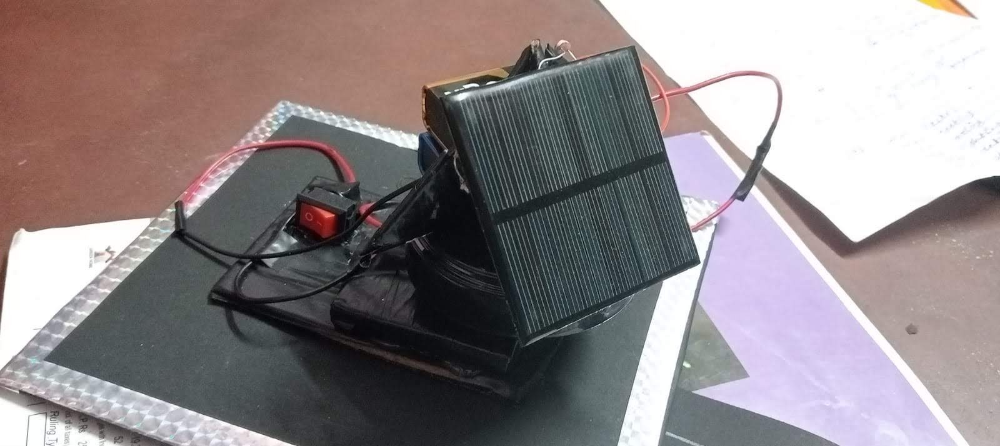

# Light-Following Solar Tracker

A small solar panel that turns itself to face the brightest light. Light sensors above the panel detect which side is brighter, and a motor rotates the panel toward it. It runs off a 9 V battery and has an on/off switch. Built in December 2023.

▶ **[Watch it track a light](demo.mp4)**
